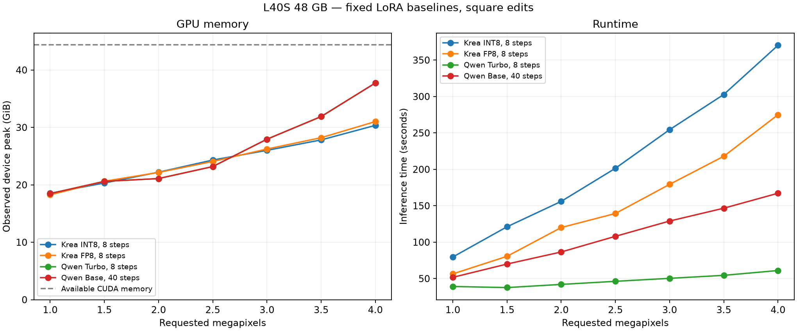

# Image megapixel calibration

This is the procedure used to calibrate the shared
[`MEGAPIXEL_LIMITS`](../../workers/shared/megapixels.py) policy. Keep measurements
and configuration together when adding a new image model or GPU tier.

## Current policy and evidence

The nominal **48 GB** tier selects **4 MP** for `krea2.fp8`,
`krea2.int8_convrot`, `qwen_image_21.base` and `qwen_image_21.turbo`.
Other tiers remain **1 MP placeholders**, including 64 GB and above. They have
not been calibrated on their corresponding hardware. The 4 MP ceiling was a
product choice; the experiment did not find the maximum possible resolution.

CUDA reports binary GiB in diagnostics, whereas the table uses nominal GB
classes. The resolver converts total bytes to decimal GB, rounds up the partial
GB, then selects the largest table key not exceeding that number. The tested
L40S reports **47,677,177,856 bytes = 44.4028 GiB = 47.6772 GB**, selecting
the 48 GB entry. Free memory is never used to select a tier. Numeric request
values bypass both hardware detection and the table.

The lookup currently considers only model profile and total VRAM. It does not
adjust for extra LoRAs, reference count, aspect ratio, explicit output size,
CFG or offload mode. A calibrated entry describes the baseline below; it does
not establish a memory bound for every accepted request. In particular, explicit
output dimensions can select a larger canvas than `reference_megapixels`.

## L40S run, 2026-10-18

**36/36 successful generations**: seven points per profile plus two additional
4 MP runs per profile. All outputs existed, matched requested dimensions and
passed a nonblank-image check. All 36 image files and the event log were checked
against their copies on Global storage using SHA-256 before stopping the Pod.

| Profile | Refs | Steps | Guidance | Fixed LoRA @ 1.0 | Largest observed peak at 4 MP (GiB) | Mean inference at 4 MP (s) |
|---|---:|---:|---:|---|---:|---:|
| Krea INT8 ConvRot | 2 | 8 | 0 | `krea2_identity_edit_v2` | 30.35 | 370.3 |
| Krea FP8 | 2 | 8 | 0 | `krea2_identity_edit_v2` | 31.01 | 274.9 |
| Qwen Turbo | 3 | 8 | 1 | `lenovo_qwen21` | 37.73 | 61.1 |
| Qwen Base | 3 | 40 | 1 | `lenovo_qwen21` | 37.73 | 167.2 |

Peak is the maximum across three 4 MP runs. Time is their mean. Qwen used
`OFFLOAD=cpu` and the texture-fix VAE. Seed was 42, with one output and the same
prompt for every request. Krea Identity Edit V2 is part of its baseline, not an
optional overhead to subtract. Its file is 1,828,285,728 bytes; Lenovo is
79,743,896 bytes and was accepted as negligible baseline overhead. There was no
no-LoRA comparison series. LoRA file sizes cannot simply be added to a VRAM
peak: runtime dtype, loading/attachment temporaries, rank and the phase that
dominates the peak all matter.

Observed device-memory peaks across the sweep:

| Requested MP | Krea INT8 (GiB) | Krea FP8 (GiB) | Qwen Turbo (GiB) | Qwen Base (GiB) |
|---:|---:|---:|---:|---:|
| 1 | 18.53 | 18.25 | 18.47 | 18.47 |
| 1.5 | 20.32 | 20.62 | 20.60 | 20.60 |
| 2 | 22.20 | 22.16 | 21.09 | 21.09 |
| 2.5 | 24.32 | 24.07 | 23.18 | 23.18 |
| 3 | 26.00 | 26.24 | 27.94 | 27.94 |
| 3.5 | 27.82 | 28.21 | 31.89 | 31.89 |
| 4 | 30.35 | 31.01 | 37.73 | 37.73 |



Requested MP and actual output area differ after alignment: at 4 MP, Krea
produced 2000x2000 and Qwen produced 1984x1984. Budget sharing also differs inside
the runtimes. Krea first divides the total reference budget on CPU, then resizes
**each reference toward the full target canvas before VAE**. Qwen preserves the
reduced reference sizes into VAE (three 1152x1152 references at 4 MP). The log
records both resized reference sizes and actual VAE encode tensor shapes.
Reference count therefore remains a separate variable, especially for Krea.

### Environment and preserved artifacts

- Dedicated L40S Pod, 48 GB class, US-NC-1, 16 vCPU, about 188 GB host RAM,
  180 GB container disk, `runpod/pytorch:1.0.2-cu1281-torch280-ubuntu2404`.
- Torch `2.8.0+cu128`, torchvision `0.23.0+cu128`, driver `570.124.06`.
  Separate Krea and Qwen venvs: Transformers 4.57.1 versus >=5.17. Qwen Diffusers
  commit `da1d3829cf08d4f329b526d89e17cc035c049d8d` with the repository's
  `diffusers-native-references.patch`. Exact installed versions are in the freezes.
- Source: commit `6f8cf4fcfba8da763348156736530376af02c715` plus the then-local
  shared megapixel feature. Patch hash and fixed settings are in the protocol.
  This was a standalone Pod test, not a production endpoint deployment.
- Input fixtures: ten 3200x3200 JPEG crops/variants of one test photo; Krea used
  the first two, Qwen the first three. These are capacity measurements, not a
  test of image quality or preservation of detail.
- Global volume `cmv1ht9mt000007lb00es0w9n`, mounted at `/workspace`.
  Persistent directory: `/workspace/benchmarks/2026-10-18-L40S-48GB/`.
  The mount was a **Global volume** (`mounts.global`), not a legacy network
  volume; querying the legacy network-volume API will not find it.
- That directory contains all PNG outputs, `events.jsonl`, `summary.json`,
  `measurements.csv`, `measurements.json`, the protocol and
  `source-and-protocol.tar.gz`. The archive includes the modified source,
  scripts, environment freezes, GPU report, fixture hashes and `photo.b64`.
- Pod `u8mukx1c04fw47` was stopped after the experiment. Its `EXITED` state was
  verified through RunPod; do not start it just to read these notes.

Small artifacts are also checked in here so knowledge does not depend on `/tmp`
or a running Pod:

- [Measurements CSV](2026-10-18-l40s-48gb/measurements.csv) and
  [structured report](2026-10-18-l40s-48gb/measurements.json).
- [Raw events](2026-10-18-l40s-48gb/results/events.jsonl),
  [suite summary](2026-10-18-l40s-48gb/results/summary.json), and
  [protocol](2026-10-18-l40s-48gb/benchmark-protocol.json).
- [Krea freeze](2026-10-18-l40s-48gb/krea-freeze.txt) and
  [Qwen freeze](2026-10-18-l40s-48gb/qwen-freeze.txt).
- Original [inference harness](2026-10-18-l40s-48gb/harness/benchmark.py),
  [suite runner](2026-10-18-l40s-48gb/harness/run_suite.py),
  [environment setup](2026-10-18-l40s-48gb/harness/setup.sh), and
  [report/plot generator](2026-10-18-l40s-48gb/summarize.py).

These scripts are frozen records of the experiment with fixed `/opt` paths,
model names and adapter names. Adapt them for new models; they are not a generic
benchmark service. The event log retains an early **startup error** caused by
an incompatible Torch/CUDA wheel; it occurred before inference and is distinct
from the 36 successful `phase: "case"` records.

## Procedure for a new image model or GPU

1. **Define one baseline.** Record model/checkpoint revision, quantization,
   VAE, offload mode, mandatory edit LoRA, one fixed optional LoRA if needed,
   strength, number of references, guidance, steps, seed, prompt, output count
   and aspect ratio. Use separate profiles for materially different runtimes.
   Use the same input fixtures across models when comparing them. Do not change
   resolution and LoRA/reference count in the same sweep.
2. **Provision one dedicated GPU Pod.** Start with the largest supported tier
   (48 GB for this run); attach the existing Global volume for LoRAs and results.
   Keep model weights, caches, clone and venvs on container disk. Do not
   repopulate Global storage with weights already downloaded from Hugging Face.
   Use a new dated results directory and do not mix events from another run.
3. **Prepare and record the actual environment.** Clone the intended revision
   and include any required local changes. Install the worker's dependencies
   and required patches. Pin Torch/CUDA wheels compatible with the driver;
   dependency installation must not silently replace them. Save source/patch,
   `nvidia-smi -q`, package freezes, input hashes and protocol before running.
   The historical `setup.sh` shows the two-venv layout; do not blindly execute
   its old checkout pin for a different model. `UV_CACHE_DIR=/opt/cache/uv` and
   `UV_LINK_MODE=copy` avoid Global mount permission/hardlink failures.
4. **Prove real CUDA inference at 1 MP first.** Check CUDA availability and a
   small tensor operation before timing. Verify the selected adapter actually
   loads/applies from logs. Use the real worker parser, normalization and
   inference call, including LoRA attachment, rather than a simplified tensor
   benchmark. Record actual source sizes before/after preprocessing and VAE
   encode shapes; trace resizing in the new runtime before assuming an MP budget
   bounds all reference activations.
5. **Sweep sequentially: 1, 1.5, 2, 2.5, 3, 3.5, 4 MP.** Use numeric
   `reference_megapixels` so the existing policy does not affect calibration.
   For a new runtime, adapt `benchmark.py` loading, request normalization and
   inference branches, and `run_suite.py` profile/venv mapping. Exercise its
   actual production defaults. Run one generation at a time on an otherwise
   idle GPU; parallel requests or another CUDA diagnostic process perturb the
   measurement. Stop on OOM; do not reuse a potentially damaged process for
   confirmation. There is no need to search above the chosen 4 MP policy cap.
6. **Measure the request, not model initialization.** Synchronize CUDA, reset
   Torch peak stats, then time inference with `torch.inference_mode()` and
   synchronize again. Include per-request LoRA attachment; exclude initial
   model loading and PNG serialization from inference time. Record
   `max_memory_allocated`, `max_memory_reserved` and whole-device usage
   (`total - free` from `cuda.mem_get_info`) sampled every 0.1 seconds. Keep the
   actual device total in bytes, not just its advertised capacity. Device
   samples can miss brief transients; Torch peaks and sampled device peaks
   measure different things. Also save CPU max RSS, timings, output dimensions,
   image and errors/OOMs.
7. **Confirm the candidate cap in a fresh process twice.** This checks the
   first request after loading and a warm repeat. Choose the largest passing
   point within the product cap and with room below available device memory;
   do not treat an allocator limit reached once as a safe operating target.
   For the historical four-profile run, the sequence was one initial 1 MP case
   per profile, six sweep points per profile, then two fresh-process confirms:
   4 x (1 + 6 + 2) = 36 generations. At 4 MP the largest sampled peak left
   about 6.67 GiB below this device's available total.
8. **Persist and verify before shutting down.** Run the suite under `nohup`,
   not attached to an SSH session. Check `status.json`/new event records about
   once a minute without issuing another generation. Sync outputs after each
   sweep and confirmation; flush/fsync copies on Global storage, then compare
   hashes. A reconnect or temporary loss of provider telemetry is not proof
   inference stopped; inspect the existing PID and event log before restarting.
   Export CSV/JSON and keep source/protocol with the run. Once complete, stop
   the test Pod, verify `EXITED` and preserve the Global volume.
9. **Update only the supported entries.** Check that the actual reported CUDA
   total selects the intended tier; add a regression test using that value.
   Record the baseline and limits next to the data. Measurements on a 48 GB
   card alone do not prove behavior on 24/32 GB cards: offload and allocator
   behavior can differ. Test other tiers, aspect ratios, reference counts or
   extra LoRAs separately before extending the guarantee. Changing the table
   does not authorize deployment.

### Historical invocation and report regeneration

With the original source, venvs, models and `/opt/bench/inputs/ref-N.jpg` already
prepared, these were the initial requests followed by the autonomous suite:

```bash
/opt/venvs/krea/bin/python -u /opt/bench/benchmark.py \
  --profile krea2.int8_convrot --refs 2 --points 1 --label initial
/opt/venvs/qwen/bin/python -u /opt/bench/benchmark.py \
  --profile qwen_image_21.turbo --refs 3 --points 1 --label initial
nohup python3 -u /opt/bench/run_suite.py > /opt/bench/suite.log 2>&1 &
```

The runner preflighted the remaining two 1 MP profiles, then swept and confirmed
all four sequentially. It wrote `/opt/bench/status.json`, per-profile logs,
`results/events.jsonl` and `results/summary.json`, and copied completed results
to the dated Global directory. For a new experiment, change these fixed
destination paths and preserve the runner's sequential execution and checkpointing.

The checked-in CSV/report can be regenerated **locally without a GPU** from the
saved raw events (Matplotlib is needed only for plots):

```bash
python docs/benchmarks/2026-10-18-l40s-48gb/summarize.py
```

This validates generation success and both confirmations per profile, then
writes CSV/JSON plus `vram-and-time.png` and `.pdf` in that directory. Output
images themselves remain on Global storage to keep the repository small.
